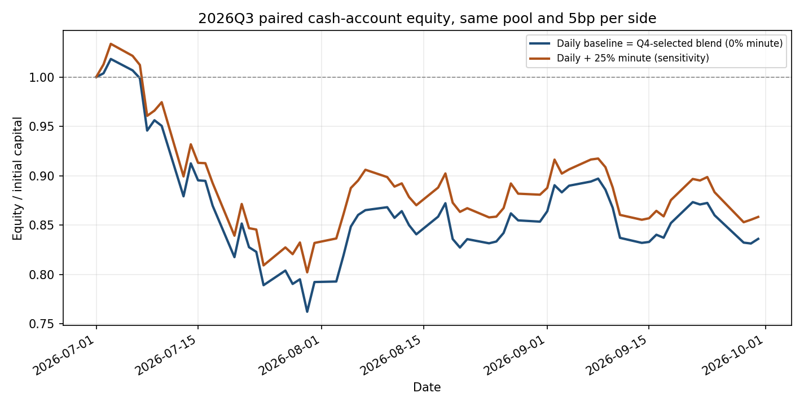

# 分钟因子对日频选股的增量实验：时间和交易核查

**事先规则的结论：2025Q4 内部验证选出分钟权重 0%，故正式叠加策略与日频基线完全相同；不能把 2026Q3 的改善倒填为事先选出的策略。**

## 具体做法

1. `intraday.py` 已从每只股票当日完整分钟线汇总 10 个数，例如最后 30 分钟涨跌、日内波动、收盘价相对全天成交均价。只在当日收盘后算完，次日开盘才可能买入。分钟文件的股票集合由前一日股票池先限制；本实验再与日频预测按日期、股票代码取交集。
2. 日频基线使用 `research_20261017/models/daily_predictions.parquet` 中的 `score_quarterly`。其 Q4 版本最后训练答案于 2025-09-30 结束，Q3 版本最后训练答案于 2026-06-30 结束，然后各自冻结整季；不是把 Q3 答案混进去。分钟附加模型单独用 2025Q4 数据训练。两种分数都在当日共同股票池内转成排名百分位，再加权。
3. 第一次分钟训练：2025-10-09 至 2025-11-21，32 天、3126 只股票日；最后一个真实答案在 2025-11-28 才结束。训练的目标是同一天股票的后 5 个交易日收益排名。10 列分钟数每天各自排名，空值补 0，Ridge 的收缩强度固定 100。
4. 内部验证：2025-12-01 至 2025-12-24，18 天、1738 只股票日，所有答案截至 2025-12-31 已结束。按每日股票分数与后 5 日实际收益的排名相关系数取平均，从预先写定的 0%、25%、50%、75%、100% 中选权重，平手优先小权重。
5. 确定权重后，用截至 2025-12-31 真正结束的 Q4 答案重新训练分钟模型：5354 行、55 天，最后出题日 2025-12-24。此后模型和权重冻结，直接预测 2026Q3；Q3 的后 5 日答案只在全部决定完成后用来核查排名，不参与任何因子或权重选择。

## 样本和覆盖

| 时段 | 分钟原始股票日 | 日频股票日 | 两边共同股票日 | 共同覆盖率（日均） | 分钟条数中位数/股票日 |
|---|---:|---:|---:|---:|---:|
| 2025Q4 | 5,982 | 6,000 | 5,847 | 97.45% | 234 |
| 2026Q3 | 6,132 | 6,500 | 6,042 | 92.95% | 230 |

只有这 2 个季度有分钟文件，不能声称历年分钟因子稳定。2026Q3 有 65 个交易日，日频股票池每日日均 100 只，交集共 6,042 个股票日；覆盖最差日仅 78%。交集外的股票，两组都不买，避免一分钟信号组因覆盖少而与不同股票池比较。

## Q4 内部验证，选择发生在 Q3 之前

| 分钟权重 | 12 月每日平均 RankIC | 是否选中 |
|---:|---:|---|
| 0% | 0.1349 | 是 |
| 25% | 0.1322 | 否 |
| 50% | 0.1246 | 否 |
| 75% | 0.1149 | 否 |
| 100% | 0.1025 | 否 |

RankIC 的意思是：同一天，预测排名与后来真实收益排名是否同向；1 表示完全同向，0 表示看不出规律。Q4 只有 18 个内部验证日，权重选择很不稳，正式按它选择仍只能是 0%。

## 2026Q3 真正逐日账本：同日、同股票池、同成本

信号日收盘后排 Top20；下一交易日开盘买，预定第 5 个交易日收盘卖。一个现金账户，不凭空反复注资；买卖两侧各按成交额收 5 个基点。考虑整手 100 股、前日成交额 1% 容量、停牌与涨跌停近似拒单、分红拆股。三组都用相同账本代码、起始 100 万元和相同日历。末日各有 20 条未平仓的持仓记录（lot，不是 20 个五日组合批次），按当天收盘价计值，未伪装成已卖出收益。

| 方案 | Q3 收益 | 最大回撤 | 夏普（无风险 0） | 卡尔玛 | 模拟交易成本 | 末日资产 |
|---|---:|---:|---:|---:|---:|---:|
| 日频基线 | -16.39% | 25.15% | -1.68 | -2.04 | 10,788.92 元 | 836,062.66 元 |
| Q4 选定的分钟叠加（0%） | -16.39% | 25.15% | -1.68 | -2.04 | 10,788.92 元 | 836,062.66 元 |
| 事先候选但 Q4 未选中：固定 25% | -14.17% | 22.39% | -1.44 | -2.05 | 11,106.34 元 | 858,302.08 元 |

固定 25% 的 Q3 收益比基线多 2.22 个百分点，回撤少 2.75 个百分点，零利率夏普从 -1.68 变为 -1.44；但二者都亏损，卡尔玛从 -2.04 到 -2.05 并未改善。固定 25% 在 Q4 反而比 0% 略差，它只是**外部测试的敏感度结果**，不能事后宣布为正式赢家。

Q3 已结束答案的每日平均 RankIC：日频 0.0767，固定 25% 0.1053，分钟单独 0.1601（每组 60 天、5,616 个股票日）。这与 Q4 验证顺序相反，提示时间漂移；只靠 Q4 的 18 天很难稳定判断分钟因子。旧分钟预测与本次分钟模型在共同 6,042 行的排名相关系数为 0.9995，说明重训与旧实验基本一致，但股票池交集使系数和原分数不必逐行相等。

## 核查边界

- Q3 标签只在建模、内部选权重、保存所有预测以及跑完账本以后，才用于 `q3_ic_daily.csv` 的解释性评估。账本用真实逐日开收盘价结算，这是回测的必要结果数据，不是训练标签。
- 日频模型是先前项目的季度冻结模型，使用 Q4 以外的历史数据；‘只用 Q4 训练’严格指本次新增的分钟模型与权重，并非整个旧日频模型。
- 旧 `intraday.py` 的完整分钟文件只覆盖 Q4 与 Q3；分钟原始供应源或复权若有误，研究会受影响。本脚本对来源文件存 SHA-256；源文件重建后须重跑。
- Ridge 的 10 个系数见 `factor_coefficients.csv`，权重检查见 `q4_weight_validation.csv`，每天三组资金见 `paired_equity.csv`，成交和拒单见对应 `*_orders.csv`、`*_trades.csv`。
- Q3 只有一个季度，固定 25% 的收益改善不足以证明以后都有效；若以后继续研究，应另取有分钟数据的新季度做真正的第二次外部测试，不应据本次 Q3 调参。
