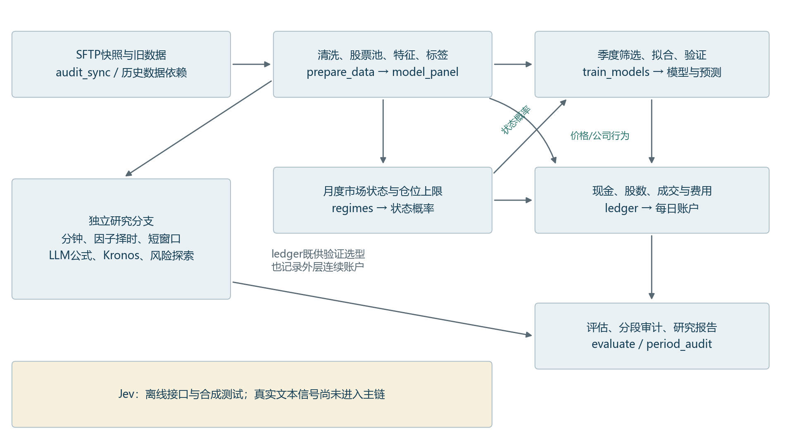

从零读懂量化项目
先知道每段代码在做什么

面向软件工程研究生｜当前代码快照：2026-10-13｜行情截止：2026-10-09

### 这个项目要解决的问题

在每个交易日收盘后，利用当时可用的价量和因子信息，对一个动态股票池里的股票排序，研究未来1、2、5、10、20个交易日期限上的相对表现。然后把评分送入带现金、持股、交易成本和成交约束的模拟账户，检验排序能否转化为有风险约束的净收益。

### 用软件工程语言理解

这是一个有时间约束的数据流水线：采集与校验 → 特征表 → 监督学习 → 批量推理 → 决策规则 → 交易模拟器 → 指标与审计。训练脚本像离线批处理；模型文件像版本化构建产物；输入哈希和运行记录类似可复现构建日志。金融上的额外困难，是未来标签要等待、行情会变、交易会受限制。

### 一个小例子

假设今天池里有100只股票，模型给100个分数，规则拟买排名前10。即使排名第一，账户也可能因现金不足、最低股数或成交容量而买不到。股票评分、计划持仓、实际成交、账户收益是四层不同的数据，必须逐层核对。

### 先明确当前结论

项目已经能够进行本地滚动实验，但还不是经过前瞻验证、可直接实盘运行的稳定盈利系统。按验证规则自动选型的方案未同时达到Sharpe>1、Calmar>2；部分历史探索候选达到全期数字，近期窗口仍失败。

学习入口只有两份：本导读负责全局地图；《02_从零讲义_第1课》只解释样本、时间轴、训练和每日预测。其余模块按课程顺序逐课展开，不要求一次学完。

## 1  完整数据流：文件怎样变成账户结果

实线表示当前数据或结果依赖；扩展分支分别研究，不能把它们的最好结果混成同一条策略。

| 层次 | 核心产物与含义 |
| --- | --- |
| 输入 | training_data/research_20261011：原始/后复权日线、供应商因子、公司行为；同时依赖9月30日和10月8日历史快照。 |
| 学习 | model_panel.parquet：每行一只股票在一个日期的特征和离线标签；models.joblib：训练后固定的模型。 |
| 决策 | h*/predictions.parquet：每天每只股票的评分；schedule.csv：由验证选择的模型配套交易设置。 |
| 执行与证据 | selected_daily/orders/trades/holdings：现金、股数、成交和净值；metrics、分段结果、核验文件供复查。 |

箭头顺序不是随意调用：run_local.ps1规定主流程。Jev默认禁止付费联网；Kronos推理独立运行；目前没有每日收盘自动调度与券商下单系统。

## 2  模块依赖：输入、动作、输出

| 模块 / 函数 | 输入 → 动作 → 输出 | 上下游 |
| --- | --- | --- |
| audit_sync.inventory / sync | 远端目录与旧快照 → 只读盘点、下载、哈希 → manifest与文件 | 准备数据前；默认复现可不联网 |
| prepare_data.main | 行情与因子 → 股票池、历史特征、未来标签、同日排名 → prices / model_panel | 依赖旧prepare.prices；供训练与状态识别 |
| regimes.main / filtered | 市场历史统计 → 月度HMM与每日前向概率 → regime_probabilities | 供条件评分、仓位上限 |
| train_models.screening | 当前训练窗 → IC近似统计、覆盖与去重 → 因子列表 | 只用当前可训练区间；最多100项 |
| fit_predict / choose / main | 训练、验证、测试块 → 拟合、验证选型、季度重拟合 → 模型/评分/设置 | choose调用ledger在验证期模拟；最终评分也交给ledger |
| ledger.Market.run / metrics | 评分、价格、公司行为、风险设置 → 逐日现金股数记账 → 账户与指标 | 各实验共同调用；主链默认5bp/边 |
| evaluate_models.main | 固定评分与账户 → 对照、费用敏感性、分段、bootstrap → 评估结果 | 不会把事后最好方案回写成自动选择成绩 |
| verify / final_checks | 合成数据及真实产物 → T+1、资金、容量、边界检查 → 检查记录 | 检查正确性；不证明未来盈利 |
| requirements_matrix / report_assets / build_report | 结果与任务 → 来源映射、图表、报告 | 展示层；不产生新的投资收益 |

独立扩展：short_windows（月度短窗）、risk_refinement与portfolio_extension（历史探索）、intraday与legacy_extensions（分钟/沪深）、factor_timing（因子收益择时）、factor_dsl（24个公式）、jev_adapter（离线文本接口）、kronos_probe（本地公开模型）。逐文件函数与行号见“核对资料/代码索引.md”。

## 3  实现状态与证据：当前能说到哪一步

| 状态 | 当前证据 |
| --- | --- |
| 已经实现并留下产物 | 335项候选输入、动态Top100、5个期限、季度监督模型、月度HMM、连续账户、分钟与短窗扩展。 |
| 已核对但范围有限 | 9项合成检查、5个期限产物检查；本次重载Q3/Q4模型，6项预测一致性检查通过。 |
| 尚未完成 | 按老师新简化协议的完整重跑、完整PIT行业/风格中性化、全部异常价格外部核验、真实Jev文本评估、每日生产调度。 |
| 未经验证的条件 | 供应商因子的历史发布版本、历史证券资格、分红真实到账和送转可卖日；旧回测不能自动保证这些条件。 |
| 待检验的研究假说 | 更短训练窗一定更好、HMM一定有增益、更多因子一定更有效、正IC足以保证多头赚钱，均不能当作事实。 |

### 先看自动选择成绩，再看探索成绩

| 预测期限 | Sharpe¹ | Calmar | 最大回撤 |
| --- | --- | --- | --- |
| 1日 | 1.061 | 1.038 | 28.00% |
| 2日 | 1.238 | 1.412 | 24.60% |
| 5日 | 1.028 | 0.940 | 23.87% |
| 10日 | 0.515 | 0.440 | 22.75% |
| 20日 | 0.228 | 0.237 | 14.78% |

¹ 固定比较口径：2024-10-08至2026-09-30，485个交易日，5bp/边，Sharpe无风险年率1.5%；数据文件h*/main_period_metrics.json。完整快照还包含10月8/9日，两种截止日期的数字不能混用。

短窗月度扩展共480组：全期41组达标，近一年0组、近半年0组，三个区间同时达标0组。1bp费用敏感性已有结果，但与按1bp重新进行完整验证选择是两件不同的实验。老师接受t+5/t+6内部一致，本轮教学沿用现有t+5定义。

## 4  学习地图：每次只讲一个模块

| 课程 | 需要理解的知识 | 学完能独立回答 |
| --- | --- | --- |
| 第1课：样本与时间轴 | 面板数据、横截面、特征/标签、fit/predict、重训与持有周期 | 100只股票×40因子怎样进模型？旧表β来自何时？ |
| 第2课：数据与股票池 | 成交量/额、价格复权、缺失、历史可得性与生存者偏差 | 为什么池子每天变？什么时候算偷看未来？ |
| 第3课：因子与筛选 | 动量/反转、Rank IC、ICIR、相关去重、多重比较 | 40/60/100项怎么选？负IC怎样理解？ |
| 第4课：模型与训练 | Ridge正则、树与提升、排序损失、验证选择、泄漏 | 学习的目标是什么？参数为什么这样设？ |
| 第5课：账户与回测 | 现金/股数、T+1、费用、分批持有、容量与延期成交 | 为什么好评分没有变成好净值？ |
| 第6课：指标与研究结论 | 年化、Sharpe、Calmar、最大回撤、分段、置信区间 | 什么算有效证据？如何避免挑好结果？ |
| 第7课：HMM与扩展 | 状态概率、风险预算、对照与消融、LLM/Jev/Kronos边界 | 增加模块是否真的产生样本外增益？ |

### 固定教学方式

每课按“直观问题 → 小数字手算 → 必要公式 → 本项目文件/函数/行号 → 自测”展开。先由你复述核心结论，再进入下一课。遇到老师追问，先给一句准确结论，再给一组数据和一处源码，不靠堆模型名回答。

### 阅读约定

金融知识在这里用于理解收益和交易约束；统计知识用于衡量信号、噪声和研究偏差；机器学习知识用于把历史映射变为可复核的预测。代码写出了某功能、检查通过了某性质、实验支持了某结论，三者分别陈述。

本次核对当前研究目录26个Python脚本、配置与流程文件及旧版必要依赖，共35个源文件；重载已存模型和读取已存结果，不重新调参、不启动SFTP同步、不调用Jev。行号以本次代码哈希为准。