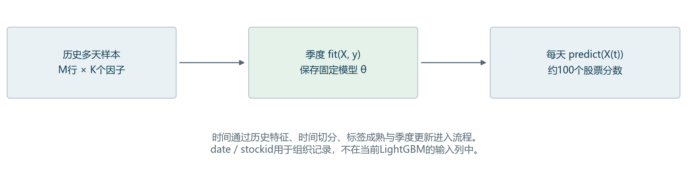
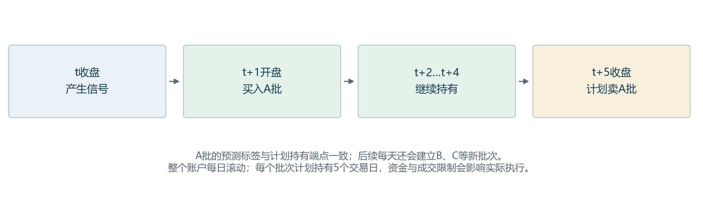

从零讲义 · 第1课
100只股票、40个因子与时间轴

本课只解决一个模块：历史记录如何进入模型，模型如何生成每天的新分数。

| 你的问题 | 直接回答 |
| --- | --- |
| 是每天的横截面回归吗？ | 每天形成一个横截面；训练时把训练窗里多天的横截面按行拼接，联合拟合一套模型。每日单独拟合100条样本并非当前实现。 |
| 时间轴怎么处理？ | 靠截至当日的历史特征、按日期切分、剔除未成熟标签、按季度更新。date和stockid不进入当前LightGBM特征矩阵。 |
| 每天收盘重训LightGBM吗？ | 主流程每季度重训；每天更新股票池、因子值和评分。短窗口扩展另用月度训练。 |
| 第11页09.2最右列是哪天的？ | 那列是旧版2026Q3的Ridge β。用2023-11-21至2026-06-23的62,466条股票日记录联合拟合，标签最晚到6月30日。它是整段历史估计出的系数。 |
| t+5/t+6如何处理？ | 接受内部一致要求。本课沿用t+1开盘→t+5收盘；明确区分5日持有与每日新建批次。 |

旧版讲40列；最新主LightGBM实际为100列。训练与预测的组织方式相同。



先记住一句话：多天联合训练一套模型，当天100行输入产生100个分数；新分数不意味着新模型。

## 1  先读懂你指出的表：一行是一项因子

### 直观解释

旧解答09.2是一张“因子统计与模型参数表”。它的20行列出第21—40个因子；训练矩阵则是一行一只股票在某天的观察。两张表的行含义不同。最右列Ridge β表示线性模型给该因子的联合系数，LightGBM的树模型没有这组固定线性β。

| 旧表列 | 含义与使用的数据窗口 |
| --- | --- |
| 覆盖率、平均IC、ICIR | 筛因子训练窗：2023-11-21至2025-12-10，499个信号日；标签最晚2025-12-17。IC是每日截面相关再对日期平均。 |
| 最右列Ridge β | 测试前最终重拟合：2023-11-21至2026-06-23，625个有效信号日、62,466条样本；标签最晚2026-06-30。 |
| 使用时段 | 2026Q3测试信号日为7月1日至9月29日；这套β在该季度固定，下一季度按新窗口重新估计。 |

### 数字例子与必要公式

表中第21项GT112的β≈0.012461。在模型计算中，若其输入排名值从0.1变成0.2，其他输入数值保持不变，则这一项对预测分数的贡献增加约0.001246。这里的分数单位来自排名标签，不能解释成股票上涨了该百分比。

Ridge分数 = b + Σ βⱼxⱼ；本轮b≈0.004833，α=10。拟合目标是让所有有效股票日样本的平方误差之和，再加10×Σβⱼ²，尽量小。40个系数共同估计，不能只看单因子IC就确定β。

源码定位：tools/research_20260930/train.py:136；rolling()中的联合拟合；下一行预测，随后保存ridge.npz。

直接证据：training_runs/teacher9_20260930/bj/2026Q3/ridge.npz、fold.json；本次从原面板重新核对样本日期与条数。模型内部的重拟合时点为“测试前”，不等于代码实际运行的系统日期。

## 2  训练矩阵：把多天横截面往下拼

### 直观解释

把它当成数据库表，主键为(date, stockid)。选定40个因子后，取40列作为X，未来收益排名这一列作为y。日期增加意味着增加行；股票池成员可以变。模型学习所有训练行共享的一套映射。

| 日期 | 股票 | 因子1排名值 | 因子2排名值 | 未来收益 | 目标y |
| --- | --- | --- | --- | --- | --- |
| D1 | A | 0.5000 | 0.1667 | +5% | 0.5000 |
| D1 | B | 0.1667 | −0.1667 | −2% | −0.1667 |
| D1 | C | −0.1667 | 0.5000 | +1% | 0.1667 |
| D2 | A | −0.1667 | 0.5000 | −1% | −0.1667 |
| D2 | B | 0.5000 | 0.1667 | +4% | 0.5000 |
| D2 | C | 0.1667 | −0.1667 | +2% | 0.1667 |

这是教学例子：2天×3只股票×2因子，X形状为6×2，y长度为6。未来收益和y仅在历史训练时已成熟后使用；预测当天模型只接收两个因子列。

### 公式与维度

X = [X_D1；X_D2；…；X_DT]，M = Σₜnₜ，X∈ℝ^(M×K)。若每一天恰好100只、500天都有效，M=50,000，K=40；现实有缺失和标签剔除，条数会减少。旧表对应最终X是62,466×40；新2026Q4的LightGBM最终X是49,872×100。

代码按行的回归误差拟合，没有显式“每日等权”训练权重；某天有效行更多，就贡献更多训练行。同日股票与重叠收益标签有关联，50,000行不代表50,000个独立金融样本。每日IC的日期平均又是另一层统计。

源码定位：tools/research_20261011/train_models.py:69；fit_predict()生成二维数组；普通回归分支执行m.fit(x,y)。

源码定位：tools/research_20261011/prepare_data.py:100；main()按date做截面排名；股票池由旧prepare.prices()构建。

## 3  标签：历史答案怎样与当天输入配对

### 直观解释与手算

t日收盘时，我们知道当天特征，但不知道随后持有的收益。历史训练时先等该收益实现，再把它贴到t日这行后面。假设次日开盘10元、t+5收盘10.50元，则这一行的5日期限收益标签为5%。

在上一页D1的3只股票中，未来收益为[5%, −2%, 1%]，从小到大名次为[3,1,2]。代码用百分位名次减0.5，因此目标是[0.5, −0.1667, 0.1667]。同日原始因子也做类似排名。它们是相对位置，不是上涨概率。

### 必要公式

rᵢ,ₜ⁽⁵⁾ = Cᵢ,ₜ₊₅(adj) / Oᵢ,ₜ₊₁(adj) − 1
yᵢ,ₜ = 当日有效收益的百分位排名 − 0.5
xᵢ,ₜ,ⱼ = 当日因子j有效值的百分位排名 − 0.5

adj表示后复权价格。3只股票例子中，中间名次是0.1667；减0.5并不保证样本均值严格为0。有并列时使用平均名次，缺值有各自的有效样本集合；模型阶段填0是中性近似。

### IC检验的是同一天的相对排序

如果3只股票预测分数为[0.3,0.1,−0.1]，分数排名[3,2,1]，实际收益排名[3,1,2]，无并列时Rank IC=1−6×(0²+1²+1²)/(3×(3²−1))=0.5。先对一个信号日的股票算，再对多个已成熟信号日平均。

普通LightGBM回归优化平方误差，模型选择又使用每日Rank IC；两者不是同一个目标。另一个ranker60才把每日股票显式分组传给排序模型。

源码定位：tools/research_20261011/prepare_data.py:72；标签起止价格；target由同日未来收益排名产生。

源码定位：tools/research_20261011/train_models.py:36；评估预测与目标时重新排名；ranker60的group在fit_predict内。

## 4  时间切分：以最新2026Q4模型为例

### 直观解释

用更早的数据学规律，用随后一段历史比较设置，到了季度边界再用当时已成熟的数据重拟合，预测下一个季度。因子滚动窗口、模型训练窗口、验证窗口和预测期限是不同的“时间长度”。

| 阶段 | 实际信号日期 / 标签边界 | 作用 |
| --- | --- | --- |
| 初始训练 | 2024-02-29至2026-03-23 / 最后标签2026-03-30 | 499个有效信号日；筛选因子并训练供验证的模型。 |
| 验证 | 2026-03-31至2026-09-30 / 跨入测试的目标值置为缺失 | 比较模型、TopN及风险规则；IC只用已成熟标签。 |
| 测试前重拟合 | 2024-09-02至2026-09-22 / 最后标签2026-09-30 | 49,872行；最新代码会重新筛因子并拟合，用于下一季度。 |
| 外层预测 | 2026-10-08起的Q4 / 当前快照只有10月8、9日 | 两天各100行；不拿这两天的未来答案训练这套模型。 |

### 排除跨界标签的公式

初始训练样本要求 label_exit < 验证开始；上线前重拟合要求 label_exit < 测试开始。即使t早于边界，只要其未来答案晚于边界，当时就不能把它当作已知训练答案。

例：9月22日信号的5日标签在9月30日结束，可以进入10月8日前的重拟合。临近测试起点、需要10月行情才能知道答案的行会剔除。代码按交易日序列移动，周末和假期不当作交易日。

源码定位：tools/research_20261011/train_models.py:121；main()构建季度训练/验证窗口与标签边界。

源码定位：tools/research_20261011/train_models.py:133；main()取最近504个名义交易日；重新筛选后拟合部署模型。

这里的“上线前”描述回放实验的信息时点。目前是本地研究，不是已运行的实盘服务。旧40因子的最终重拟合用更长的约630日范围，新版用最近504日，不能混用日期解释。

## 5  每天预测：换输入，沿用本季度模型

### 直观解释与本地复核

fit负责学习模型内部参数；predict只把新X代入已学映射。旧模型可因当天因子变化而输出不同分数。本次加载已存Q3/Q4模型，对同一测试数据分别整季预测和逐日预测，结果最大差值均为0，也与原保存预测完全一致。

| 信号日期 | 股票 | lgbm100分数 | 参数版本 |
| --- | --- | --- | --- |
| 2026-10-08 | BJ920002 | 0.011977 | 同一2026Q4模型 |
| 2026-10-08 | BJ920006 | 0.011539 | 同一2026Q4模型 |
| 2026-10-08 | BJ920008 | -0.004725 | 同一2026Q4模型 |
| 2026-10-09 | BJ920002 | 0.023382 | 同一2026Q4模型 |
| 2026-10-09 | BJ920006 | 0.038927 | 同一2026Q4模型 |
| 2026-10-09 | BJ920008 | 0.025807 | 同一2026Q4模型 |

上表为真实保存输出。两天的5日标签在当前快照中均未成熟，但仍能预测。Q4自动选择的score实际来自xgboost60，不能把文件最后一列或score自动叫作LightGBM输出；本表专门读取lgbm100列。

### 必要公式与对应调用

同一季度内：sᵢ,ₜ = f_θQ(xᵢ,ₜ)，θQ固定，xᵢ,ₜ每天更新。LightGBM不接收date/stockid列，也没有隐藏的RNN记忆；mom20等输入已总结了该股过去20日的信息。

```python
X = train[features].fillna(0).to_numpy()
y = train["target_5"].to_numpy()
model.fit(X, y)       # 季度边界拟合
X_today = today[features].fillna(0).to_numpy()
scores = model.predict(X_today)  # 每日推理
```

源码定位：tools/research_20261011/train_models.py:72；fit_predict()实际对test整块预测；代码示例仅突出fit/predict，不是完整重跑命令。

历史批量predict可以包含后来日期的特征，因为每行独立代入固定模型；这本身不会让较早行看到较晚行。但特征构造和供应商数据可得时间仍须单独防泄漏。本次没有重新训练模型。

## 6  四种频率：重训、评分、新建批次、退出

### 先把当前实现说准确

| 动作 | 主流程频率 | 时间用途 |
| --- | --- | --- |
| 股票池 / 特征 / 评分 | 每日 | 收盘信息更新后，对当日最多100只评分。 |
| 监督模型 / 入选因子身份 | 每季度 | 季度边界重新筛选、拟合；短窗实验单独按月。 |
| HMM参数 / 状态概率 | 参数按月；概率每日 | 不等于LightGBM每日重训。 |
| 新建持仓 / 每批计划退出 | 每日尝试建批；h=5按第5日退出 | 现金允许时新批预算≤净值/5；受仓位、单股与容量限制。 |

以信号日t为起点，5日批次覆盖t+1至t+5。后续批次会重叠，收益标签也会重叠。



例如t+1开A批、t+2开B批、t+3开C批；A在t+5收盘计划退出，B在t+6收盘计划退出。这个账户每日有交易机会；5日描述每个批次的计划期限。

接受“内部一致”后，本课保留当前t+5定义：IC标签和该批计划买卖端点一致。实际风险减仓、停牌或容量不足可能让真实退出偏离计划，账本应如实记录；IC也因此不等于成本后账户收益。若采用“每5天全仓换一次”，还需另加信号间隔规则，并在相同信号日检验IC；当前主账本没有这一规则。

源码定位：tools/research_20261011/ledger.py:124；Market.run()设置到期日；每天取上一日信号，按h控制新批预算。

预测20日、实际持有5日的历史探索是另一种设计。本轮基础教学和内部一致的基线不把它当作“20日预测、20日持有”来汇报。

## 7  这一课学完，应能怎样向老师汇报

### 可直接复述的回答

我们的样本单位是股票—日期。每天先形成一个横截面，把训练窗内多天的横截面按行拼接，用共同的LightGBM回归模型学习未来收益的截面排名。时间通过历史特征、按日期切分和标签成熟边界体现；主模型按季度重训，季度内每天换输入做预测。旧40因子表最右列属于另一条Ridge基线，是测试前用625个有效信号日联合估计的系数。当前5日账户每日建批、每批计划5日退出；我们会保持IC与所声明的交易时点一致。

### 先合上讲义，回答四个小问题

| 自测 | 简短答案（先遮住右列） |
| --- | --- |
| 100只股票×40因子×300天，无缺失，X多大？ | 30,000×40；每个测试日输入100×40，输出100个分数。 |
| 同一股票今天分数变了，模型一定重训了吗？ | 不一定。同一模型接收新因子值，就会得到新分数。 |
| 旧表GT112的β=0.012461，是哪天的IC？ | 它是多天联合拟合的Ridge系数；IC另列，含义与样本窗口不同。 |
| 10月9日的5日收益还不知道，能预测吗？ | 能。预测只需要当日X和已训练模型；成熟后才能算该日IC。 |

### 下一次只讲第2课

下一课聚焦“原始行情怎样变成每天的股票池和因子输入”：用成交额手算Top100，用分红/拆股例子理解复权，再定位可得时间与缺失处理。不同时展开HMM、Jev或全部评价指标。

### 本课代码与来源

源码行号随本次哈希保存在核对资料中；真实推理核对见tools/learning_20261013/audit_project.py，6项一致性检查均通过。旧β解释另核对原始ridge.npz与旧面板，不用当前模型参数反推旧表。

[LightGBM官方：二维特征输入、fit与predict](https://lightgbm.readthedocs.io/en/stable/pythonapi/lightgbm.LGBMRegressor.html)

[LightGBM官方：排序模型的group定义](https://lightgbm.readthedocs.io/en/stable/pythonapi/lightgbm.LGBMRanker.html)