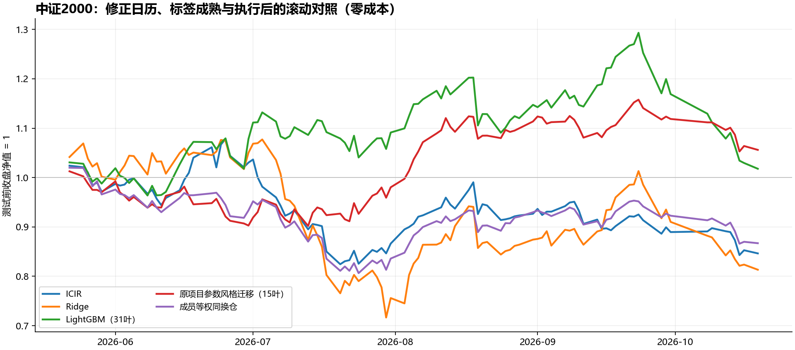
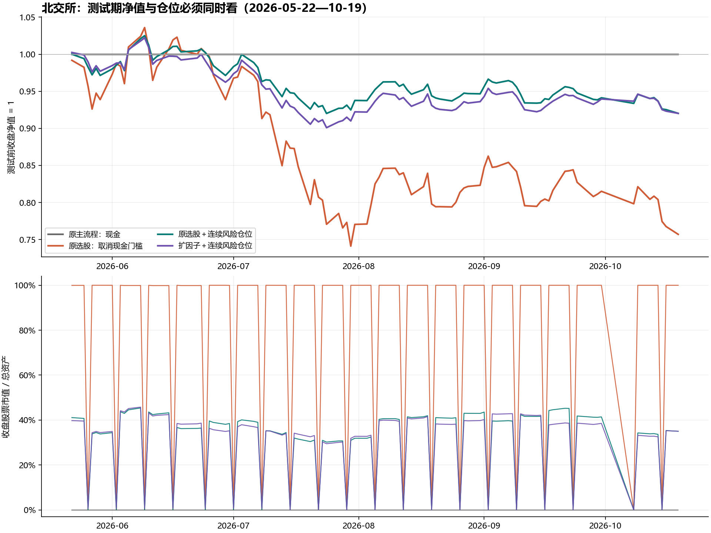
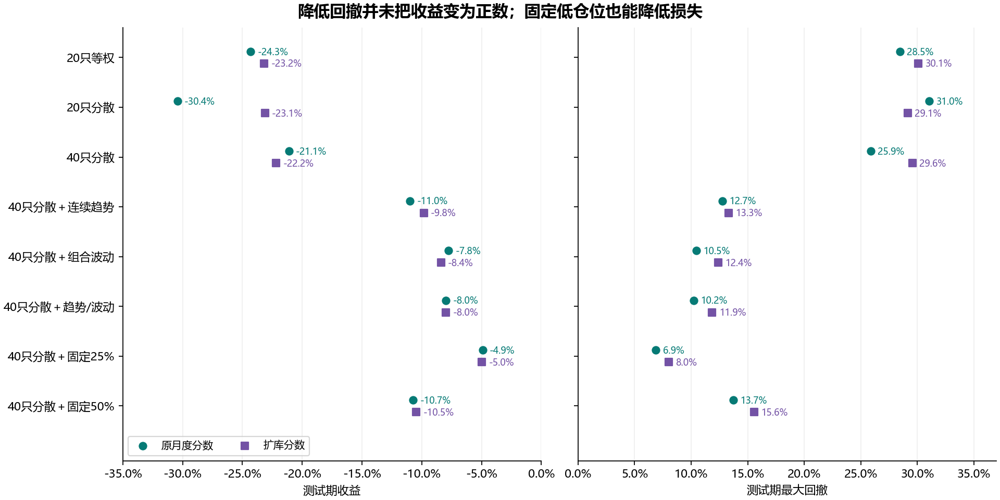

# WorkBuddy全量复盘与实验重跑

日期：2026-10-21。任务范围：复盘用户粘贴汇总中的全部问答、成分重建、原实验测试期、空仓决策、分散/趋势/波动规则与FTP全因子扩充。

## 先给结论

**旧实验有实质性错误，不能直接采信旧中证2000成绩；成分重建的数学方法可行，但原报告把资料完整性和日期确定性说得过满。原北交所主流程在张子晨指定测试期为全现金、收益0%，它没有回答选股在该期是否有效。**

本轮保留并重现原流程，另存修正实验。扩库已经实际取数、训练、回测，未找到足以证明稳定改进的结果。降低回撤主要依靠风险预算与仓位变化，不能当作Alpha增强；不能将现在已看过的test再称为真正未见样本。

## 1. 倒推成分合理吗

用户原件共有 **4510行**：初始纳入2000行，随后进出2510行；不是“2000行外加4510行”。本轮独立检查：无重复事件、无非法加入/剔除，顺推后再逆推能精确回到初始集合。它实际上主要是**从初始名单顺推**，并不是用未来收益猜名单。

规则很简单：`新名单 = (旧名单 − 生效剔除) ∪ 生效纳入`。有可信初始集合、完整事件和准确生效日时，这是一种合理的确定性重建。

但现有资料仍不足以将其叫作“官方逐日真实PIT名单”：

- 没有取得独立的2026-09-30官方锚点；所谓9-30基准表本身也是同一份记录推出来的，不能拿它自证。
- 记录日期是否等于生效日、公告是否当时已经发布，未逐事件独立确认。
- 10-20官方名单多出SZ001268、SZ002259，重建名单多出SH603680、SZ300277。**这只证明集合有差异，不能证明一定在9-15至10-06发生了“一次调整”，更不能声称“不影响9-30”。**也不能排除记录漏项或映射问题发生在其他时点。
- 每天2000只只是数量校验；即使误换了两只，数量也仍是2000。
- 原表中的当下简称、行业、市值、“调整后表现”等字段不用于历史选股。本轮重建只使用日期、代码和进出动作。

因此本轮中证2000结果均标为：**基于用户事件记录重建池的条件性研究**。9-14以后名单按未变延续，属假设；将差异4代码从9-15以后排除的敏感性检查没有改变两个LightGBM组合成绩，但这不是独立成员真实性证明。原先“缺逐日名单所以绝对不能做”应改成“可先检查事件表是否足以可靠重建”；“拿当前名单倒填全部历史”仍不成立。

## 2. WorkBuddy代码中查到的实质错误

| 问题 | 本轮证据 | 对结果的影响 |
|---|---|---|
| 先筛成分，再按个股剩余行shift(-5) | 3,477条保存标签的终点不是第5个市场交易日，最远610日 | 调出后再调入、停牌会把数月/数年的收益当五天；把实际未来数据混入早期训练 |
| 训练与内部验证没有gap | 22/22折存在训练标签伸入验证段 | 内部验证不独立 |
| 验证与预测虽写gap=6，但标签实际跨越 | 22/22折有验证标签终点越过预测起点；20/22折训练标签也越过预测起点 | 仅移动行号，不能保证答案当时已成熟 |
| 报告称隔离2025-06-04—07-01不用 | 16个滚动折的训练或验证实际用了该段 | 声明与实现不一致；滚动使用过去成熟数据本身可合法，但不能声称从未使用 |
| 先删除未来标签缺失行，再挑Top20 | 22个“模型×调仓批次”受影响，含终点未成熟批次 | 用未来可得性改变当日可选股票，有选择偏差 |
| 价格代码修补不完整 | 扩展行情中4,464行、48个北交所代码为纯6位；简单把尾部市场前移不能修复它们 | 部分北交所行情被漏接，不是“全成员行情无缺失” |
| 基准与策略期末不等长 | test策略19个非空批次，指数20批；末批2026-10-14策略全无标签但指数仍算收益 | 旧“指数−21.9%”与策略不是同一有效样本 |
| 只按批次末尾计算回撤 | 缺少批次内部逐日盯市 | 会漏掉持有期内最大回撤；不能直接和逐日账户夏普比较 |
| V/test按信号日分组，收益窗口跨界 | 2026-05-18信号收益结算到05-25，被归入V | 边界存在结果重叠；本轮按连续账户实际交易日切片 |
| 声称严格对齐，却用了另一收益标签 | 旧版open(t+1)→close(t+5)，所述比较口径open(t+1)→open(t+6) | 缺少一段隔夜收益，不能称逐项同口径 |

最严重的具体例子：SH601163在2023-12-04的“未来五日收盘”被接到2026-06-15。不是普通的小数误差。详细逐行证据在`old_label_calendar_errors.csv`、`old_fold_leakage.csv`、`old_future_label_selection.csv`。

本轮先在完整行情和统一市场日历上生成标签，再按信号日成分取样；每条训练/验证标签都检查实际终点，分数表不靠未来标签决定股票是否可选。组合按逐日资产估值，未成熟末批继续盯市，不伪造完整持有期收益。

## 3. 27%、50.54%仓位的原解释哪里准确、哪里不准

`平均仓位 = mean(每日收盘股票市值 / 当日总资产)`这一公式正确；平均仓位50.54%、收盘仓位低于1%的交易日占40.62%、全期回撤约28.26%、全期夏普约1.54/卡玛约2.36可从旧账本复算。它们是收盘口径。五日批次在第五日收盘退出，当天收盘仓位为0，不能理解成那一整天都没持仓。

**把初始100万元直接乘平均仓位，解释成真实平均投入金额，则不精确。** 净值在变，平均市值应计算`mean(仓位_t × 总资产_t)`。

| 同一旧对照区间 | 平均收盘仓位 | 平均总资产 | 平均股票市值 |
|---|---|---|---|
| 1017月度主流程 | 50.54% | 266.03万元 | 130.31万元 |
| 1011旧主流程 | 27.79% | 146.49万元 | 40.85万元 |

上述区间均为2024-10-08—2026-09-30。新主流程平均股票市值约130.31万元，不是50万元；“总资产一直固定100万时，50%约等于50万”才是正确的示意。另一个表述错误是“100股整手”：源码实际为最少100股、之后整数股；1439笔已成交买单中1431笔不是100的倍数。

新旧平均仓位差不能仅归因于月度重训“信号更密集”：新实验中月度与季度预测都逐日打分、都每五日发一批交易。差异还来自现金/风险规则、批次和执行约束；须靠消融而非一句原因归纳。

## 4. 2026Q2、Q3为什么空仓，这样做对吗

源码没有硬编码“2026Q2/Q3=现金”。每季度用过去126交易日比较6套规则，要求扣费后收益>0且完成卖出部分数>=5，再最大化`min(Sharpe_rf1.5, Calmar/2)`；否则现金。Q2、Q3六套候选全部亏损；实际成交部分数均远高于5，**这里真正的触发原因是收益门槛，不是成交不足**。

现金可以是预先规定的风险选择；它减少的是这套策略的风险暴露。不能从“六套候选都没过线”推导出“市场没有上涨股票”。期初旧动态100只池中，Q2有19只季度上涨，Q3有17只上涨；这是事后机会统计，不代表当时能准确挑中它们。

该规则的问题是：正收益0门槛很硬、只用一个近期窗口、整季度不恢复评估，混合了选股能力和市场方向。它可能过度保守。并且规则是2026年10月在已查看历史后提出，**验证期滚动选择并不能消除研究者层面的事后设计与过拟合**。目前没有证据判定人为篡改季度，但也不能据此宣称无过拟合。

空仓不一定机械提高夏普/卡玛：避开亏损可能改善相对全仓结果；单纯追加零收益日期会降低年化收益，全现金自身方差/回撤为零，夏普和卡玛应记不适用。正确做法是同时报收益、回撤、持仓比例、同分数固定仓位对照及参与市场时的表现。

## 5. 张子晨真正问的“原实验测试期”

用户补充聊天明确问2026-05-22—2026-10-19，而不是让新写三模型替代原项目。WorkBuddy没有直接回答这一点。

本轮保留1017版全部历史模型分数和历史账本输入，只补10月所需数据并按原9候选模型及原6风险规则产生Q4。Q4模型选出`pca_lgbm_252_100_half63`，但六风险候选仍未满足收益门槛，最终风险方案为cash。延长前历史每日净值最大复现误差为4.66×10⁻¹⁰元。

测试期间100个交易日，以下为连续账户按5月21日收盘净值切片，保留已有持仓，而非重新挑选起点：

| 原流程对照 | 测试收益 | 最大回撤 | 夏普（rf1.5%） | 平均收盘仓位 |
|---|---|---|---|---|
| 原月度主流程（含现金门槛） | +0.00% | 0.00% | 不适用 | 0.00% |
| 原月度选股，取消现金门槛 | -24.30% | 28.45% | -1.77 | 79.98% |
| 原季度更新，保留同一现金门槛 | +0.00% | 0.00% | 不适用 | 0.00% |
| 原IC20选股，取消现金门槛 | -26.98% | 33.64% | -1.81 | 79.98% |

因此原主流程的0%只说明持币避开了损失；去掉现金门槛，原月度分数亏24.30%，原IC20亏26.98%。这才直接回答同学关于原策略在新增测试器中的表现。原项目是北交所动态流动性池；不能和中证2000成绩混成同市场比较。

## 6. V和test到底是不是OOS

- 对某次模型的参数拟合而言，未送进拟合的数据可以是OOS预测。
- 内部validation用于选Ridge惩罚、停止树的轮数后，就已参与模型选择；不能当完全独立最终测试。
- 外部V若用于反复选因子、风险规则、窗口，也不是研究决策层面的未见样本。
- 合法walk-forward可以在下一折使用已经结束的前一折test标签，前提是交易时确实已经成熟；这叫在线滚动，不是冻结模型测试。
- 本轮统一test从05-22开始，外部V止于05-21。另保留05-25起算行用于核对旧报告。

新滚动：252个市场交易日训练 → 6日gap → 63日内部验证 → 6日gap → 21日预测。实际标签终点再做严格检查。另跑固定模型版本，所有拟合/调参数据止于原训练截止之前，V和test期间模型保持不变。两种部署策略分别报告，不能偷偷混用。原指定2025-06隔离只适用于固定切分叙述，滚动版本不再声称整段永不使用。

## 7. 中证2000修正重跑

Alpha101，截面1%/99%去极值、标准化、缺失补截面均值0；主标签为后复权open(t+6)/open(t+1)−1，标签减当日截面均值。ICIR、Ridge、31叶LightGBM，以及原项目15叶、L2=12、秩目标的参数风格迁移对照。后者是迁移实验，**不是原北交所完整策略**。

Top20等权，信号次日开盘成交，五个开盘间隔后退出；按逐日净值算指标。统一日历、不因调出成分删掉持有期行情；缺开盘的订单保留现金，缺卖出价的残留继续处理，但不冻结其他现金。相同成员等权基准使用相同成交时点。这里是可分割份额的研究组合，尚未实现全A股精确涨跌停、ST、撮合和容量约束，不等于可实盘收益。

| 部署 | 模型 | V收益 | test收益 | test最大回撤 | 日频夏普rf0 | 卡玛 |
|---|---|---|---|---|---|---|
| 滚动 | ICIR | +17.76% | -15.36% | 23.54% | -1.16 | -1.46 |
| 滚动 | Ridge | +47.15% | -18.66% | 33.48% | -0.87 | -1.21 |
| 滚动 | LightGBM（31叶） | +41.07% | +1.78% | 21.30% | 0.30 | 0.21 |
| 滚动 | 原项目参数风格迁移（15叶） | +43.53% | +5.61% | 10.93% | 0.67 | 1.35 |
| 滚动 | 成员等权同换仓 | +27.70% | -13.30% | 20.94% | -1.27 | -1.44 |
| 冻结拟合 | ICIR | +17.79% | -16.44% | 29.09% | -1.11 | -1.25 |
| 冻结拟合 | Ridge | +11.33% | -26.06% | 42.14% | -1.28 | -1.26 |
| 冻结拟合 | LightGBM（31叶） | +18.83% | -16.60% | 26.07% | -1.17 | -1.41 |
| 冻结拟合 | 原项目参数风格迁移（15叶） | +9.45% | +1.25% | 14.08% | 0.25 | 0.23 |
| 冻结拟合 | 成员等权同换仓 | +27.70% | -13.30% | 20.94% | -1.27 | -1.44 |

相同test交易日的官方全收益指数收盘参考为-19.60%（5月21日收盘到10月19日收盘），不是旧表的−21.9%；其close→close和策略open→open并非完全相同交易时点，因此标为市场参考，同执行的成员等权才是选股基线。

| 滚动模型 | 情景 | test收益 | test最大回撤 |
|---|---|---|---|
| LightGBM（31叶） | 每边0bp，延迟0日 | +1.78% | 21.30% |
| LightGBM（31叶） | 每边5bp，延迟0日 | -0.22% | 21.45% |
| LightGBM（31叶） | 每边15bp，延迟0日 | -4.11% | 21.76% |
| LightGBM（31叶） | 每边0bp，延迟1日 | -5.24% | 21.00% |
| 原项目参数风格迁移（15叶） | 每边0bp，延迟0日 | +5.61% | 10.93% |
| 原项目参数风格迁移（15叶） | 每边5bp，延迟0日 | +3.52% | 11.55% |
| 原项目参数风格迁移（15叶） | 每边15bp，延迟0日 | -0.54% | 12.78% |
| 原项目参数风格迁移（15叶） | 每边0bp，延迟1日 | +0.84% | 12.20% |

31叶LightGBM零成本仅+1.78%，每边5bp就变−0.22%，延迟一天变−5.24%。15叶迁移版本零成本+5.61%，每边15bp变−0.54%。**不能从本次试验中事后挑15叶赢家宣称上线达标。**旧报告−0.5%和本轮数字也不能被解释为某一个bug的单独贡献：标签、价格调整、切分与执行均发生了必要修正。

## 8. FTP因子库究竟扩大到哪里

真实读取120张表的最新样本、数据字典及历史文件；按原项目五交易日调仓网格，取2023-08至2026-10的154个信号日期，下载并保留 **18,112个历史ZIP，约9.11GB**。这是全表、固定信号日采样，**不是全部历史日频ZIP**。另重新获取原始/后复权行情及北交所前复权、分红资料，逐文件有SHA-256。

- 进入统一字段目录：**2,445列**，来自120表；不含股票代码、报告日期、公告时间等标识字段。
- 较保守量价/交易/技术候选：1601列；财务、股本/披露相关340列和关系网络相关504列因历史可得性未核，单列供应商快照敏感性版本。
- 发现375,593条源记录的内容日期比文件名早超过7天。量价数据过旧不当作新值；财务快照明确标记。
- 财务事件表有16,901条记录的公告/实际入库时间不满足相应文件日可得性，已剔除。这个数字是跨下载文件的源行数，不是独立财务事件数。
- 逐训练折覆盖>=70%、去常量，按训练相关性/稳定性筛选并限制单来源占比、去近重复，树模型最多100列；全列Ridge实际使用约1511—1518列保守候选，全部供应商版本约2262—2269列。所有未入选因子有逐折理由。
- 2445列中全期描述性全缺54列、常量或全缺85列；这些全期统计仅用于报告，实际筛选只看当折训练期。不能为了“全用上”把缺失、标识或未来信息强行送入模型。

所有比较使用相同北交所动态100只池、同一五日采样、同样早停和执行口径；不把不同采样下原模型与新模型的收益差全部归于扩因子。模型验证采用逐日Spearman；扩库训练筛选统计为标准化因子与收益秩标签的截面相关系数。

### 同执行、20只等权、每边5bp的扩库比较

| 因子/模型版本 | V收益 | test收益 | test最大回撤 | test夏普rf1.5% |
|---|---|---|---|---|
| Alpha101→筛选→LightGBM | -17.24% | -21.46% | 26.51% | -1.57 |
| Alpha101＋191→筛选→LightGBM | -14.48% | -29.17% | 31.55% | -2.15 |
| 扩充量价库→筛选100→LightGBM | -14.31% | -23.17% | 30.08% | -1.59 |
| 扩充量价库→全部合格列→Ridge | -1.80% | -19.00% | 23.49% | -1.29 |
| 全供应商库→筛选100→LightGBM（时点未核） | -16.09% | -23.77% | 29.59% | -1.66 |
| 全供应商库→全部合格列→Ridge（时点未核） | -2.49% | -17.55% | 26.90% | -1.16 |
| 移除微观结构族→LightGBM | -14.98% | -18.62% | 28.87% | -1.27 |
| Alpha101相关系数加权基线 | -25.18% | -25.60% | 30.29% | -1.91 |

**扩库已完成，但扩库不等于效果提高。**保守扩库LightGBM test−23.17%，比同实验Alpha101的−21.46%还差；全列Ridge的改善也没有形成显著且稳健的增益。20日区块、1000次配对重采样中，各扩库相对Alpha101的年化平均日收益差区间均跨零。该区间只是已观察小样本的不确定性诊断，不是多重比较校正后的“通过证书”。

## 9. 分散、趋势、波动规则重跑，以及隐藏的现金问题

固定对照包括20/40只、行业最多30%、规模/动量/波动分组最多50%的建仓限制；趋势用过去20/60日风险调整涨跌和上涨广度连续定仓，波动用候选组合过去20/60日收益风险估计、目标年化15%；组合取趋势/波动两种仓位较低值。风险目标最低25%、最高95%，每次五日调仓重新计算，未因月份写空仓。限制是在建仓时约束，日后价格漂移可能改变持仓比例。

首轮继承旧执行代码时，发现不足1%的残留持仓会锁住全部新买入。扩库40只组合因此连续跳过7批，test看起来只亏1.67%、回撤3.69%。**这主要含有执行停摆带来的低暴露，不能拿来作为优化成绩。**已保留在`06_旧执行残留锁仓诊断.csv`。

下表采用修正执行：残留每天尝试退出，剩余现金照常参与调仓；持仓市值计入总目标、个股和行业/风格约束，一份现金、无借贷、保留T+1、前20日成交额1%容量代理。风险下限是目标仓位下限，不保证实际仓位始终达到25%；第五日收盘退出、停牌、现金/容量和最小100股等均影响实际仓位。

| 同一选股分数 | 风险规则 | test收益 | test最大回撤 | 夏普rf1.5% | 卡玛 | 平均收盘仓位 |
|---|---|---|---|---|---|---|
| 原月度分数 | 20只等权 | -24.30% | 28.46% | -1.77 | -1.72 | 79.98% |
| 原月度分数 | 20只分散 | -30.44% | 31.04% | -2.37 | -1.88 | 79.98% |
| 原月度分数 | 40只分散 | -21.11% | 25.87% | -1.55 | -1.69 | 79.97% |
| 原月度分数 | 40只分散＋连续趋势 | -10.99% | 12.74% | -1.94 | -1.93 | 36.50% |
| 原月度分数 | 40只分散＋组合波动 | -7.76% | 10.47% | -1.41 | -1.70 | 32.56% |
| 原月度分数 | 40只分散＋趋势/波动 | -7.97% | 10.23% | -1.57 | -1.78 | 30.79% |
| 原月度分数 | 40只分散＋固定25% | -4.90% | 6.88% | -1.61 | -1.66 | 18.89% |
| 原月度分数 | 40只分散＋固定50% | -10.74% | 13.74% | -1.63 | -1.75 | 39.71% |
| 扩库LightGBM | 20只等权 | -23.17% | 30.08% | -1.59 | -1.57 | 79.96% |
| 扩库LightGBM | 20只分散 | -23.12% | 29.15% | -1.66 | -1.61 | 79.97% |
| 扩库LightGBM | 40只分散 | -22.17% | 29.55% | -1.65 | -1.54 | 80.08% |
| 扩库LightGBM | 40只分散＋连续趋势 | -9.83% | 13.32% | -1.73 | -1.66 | 35.79% |
| 扩库LightGBM | 40只分散＋组合波动 | -8.39% | 12.37% | -1.56 | -1.54 | 31.84% |
| 扩库LightGBM | 40只分散＋趋势/波动 | -7.98% | 11.86% | -1.60 | -1.54 | 30.20% |
| 扩库LightGBM | 40只分散＋固定25% | -4.96% | 8.00% | -1.61 | -1.45 | 18.95% |
| 扩库LightGBM | 40只分散＋固定50% | -10.46% | 15.56% | -1.58 | -1.51 | 38.85% |

可以看见：20只分散甚至可能比20只不分散更差；40只、趋势和波动预算减小了损失与回撤，但收益仍负。固定25%仓位也能使损失显著缩小，所以不能只凭“回撤不到20%”证明复杂风控有效。两类分数配合组合风险规则均约亏7.98%，并未证实扩因子有稳定增益。

## 10. 防过拟合的实际措施与还没解决的边界

已落实：实际标签终点purge、时序滚动不随机拆分、训练内筛选与来源上限、Ridge收缩、保留简单基线、微观结构族消融、固定25%/50%仓位对照、5/15bp费用、延迟执行（CSI延迟1日、北交所稀疏信号延迟一个5日周期）、保留失败组、区块不确定性诊断。原代码和旧报告不覆盖，全部新候选输出保留。

尚未解决：独立历史成分锚点和逐事件公告/生效时点；所有供应商历史文件的首次发布/修订；完整历史退市/ST可交易状态；精确涨跌停与股息到账/可卖日；真实成交与未来未见样本。CSI结果仍依赖重建池，北交所仍依赖可得文件股票全集和执行代理。训练外预测不等于完全PIT实盘重演。

**本轮不能宣布稳定达成老师的夏普、卡玛或收益目标，也不应把本轮最好结果直接替换成“主流程”。** 下一步应冻结少数有经济解释的方案，在之后真实未查看的日期做前瞻纸面运行；没有新数据时，可检验实现和稳健性，不能凭反复调test制造独立证据。

方法依据：[scikit-learn时间序列切分与gap说明](https://scikit-learn.org/stable/modules/generated/sklearn.model_selection.TimeSeriesSplit.html)；[Bailey等《回测过拟合概率》原论文](https://www.davidhbailey.com/dhbpapers/backtest-prob.pdf)。本轮不声称已经计算论文中的PBO统计量。

## 11. 核验与复现

10项关键检查通过：改变未来标签不改变持仓、缺买入价不按未来收益换股、精确五个开盘间隔、残留不锁其余现金、初始资本纳入回撤、随机300条日历标签独立重算、新折实际标签终点隔离、未来市场变化不影响过去风险仓位、原历史账本重现、120表哈希及下载错误检查。所有新账户现金+股票市值恒等式也已检查。

目录：

- `tools/audit_rebuild_20261021/`：协议、下载、审计、模型、两个执行版本、报告与测试脚本。
- `training_data/audit_rebuild_20261021/`：原始ZIP、价量/分红、逐文件哈希、解析结果和日志。
- `training_runs/audit_rebuild_20261021/`：逐行问题、模型、预测、筛选、逐日账户与全部结果。
- 本文件夹：便于阅读的报告、3张图和6份汇总CSV。`交付校验.json`记录主要文件哈希。

先运行`inspect_sources.py`本地/远程清单、`fetch_library.py`、`fetch_prices.py`；再依次运行`audit_old.py`、`original_extension.py all`、`csi_rebuild.py all`、`expanded_factors.py all`、`build_risk_engine.py`、`risk_experiments.py`及`risk_experiments.py --rebalanced`、`test_invariants.py`、`build_report.py`。Python环境为项目已有`.venv_research_20261011/Scripts/python.exe`。下载器只读SFTP；凭证由本地连接文件读取，不写报告。

已完成审计与重跑不等于证明策略有效；没有通过的结论也属于本轮实验结果。
