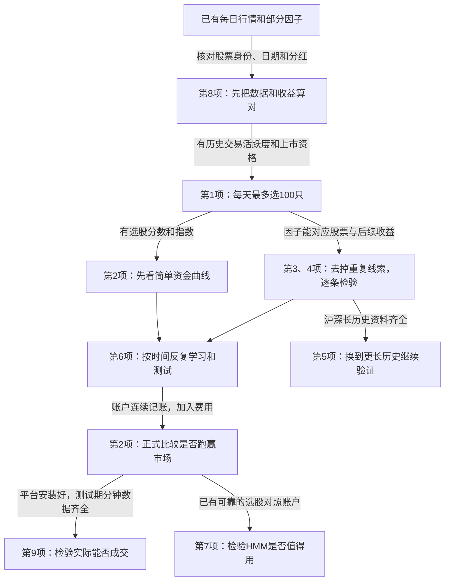

# 小白版：先准备什么，再解决老师的九个问题

> **后续实际完成情况（2026-09-30）：** 已用现有数据完成可运行的研究流程和新回测，见[九项意见实施结果报告](../老师意见实施_20260930/老师九项意见_实施结果与效果报告.docx)。可以把它理解为：现在不仅列出了“怎么做”，也实际跑出了成绩；但成交约束、分红送转和历史股票身份仍会影响成绩，暂不能当作实盘效果。下文保留此前准备阶段的说明。

最新更新：2026 年 9 月 30 日。服务器核查时间为北京时间 09:18—09:22，检查到已结束的 9 月 29 日，9 月 30 日尚未收盘，不计缺失。下文的数据现状已按这次核查更新，九项意见的解释和实施思路继续保留。详细证据见[最新服务器核查](../服务器数据核查_20260930/服务器文件更新与缺口.md)。本次只读取服务器并更新本地笔记，未训练或运行新回测。

**先把项目说成一句人话：我们在做一个选股助手，让它每天从一批股票里挑出未来几天可能表现较好的股票，再用历史记录检验它到底有没有用。**

老师的九个意见，其实是在问三件事：喂给助手的资料是否可靠？助手有没有稳定地选对？选出来以后，钱是否真的赚得到？

你不需要先学会全部金融知识。沿着下面的顺序，每做一步就能理解一个问题。

**先看数据：现在有什么，接下来准备什么**

| 需要什么 | 它有什么用 | 这次服务器核查结果 | 下一步准备 |
|---|---|---|---|
| 每只股票每天的价格、成交量和成交额 | 知道涨跌，也知道买卖是否活跃 | 新北交所 raw/qfq 各有 350 个文件，其中 348 个到 9 月 29 日；另两个文件名带“退” | 核对新增股票的上市资格、零成交记录，以及退市股票的最后交易日；文件数量不等于每天可交易股票数 |
| 历史股票资料：代码、哪天上市/退市、哪天暂停交易 | 知道过去某一天究竟可以买哪些股票 | 在本次查看的数据目录中，尚未确认有完整的专用历史表；不等于服务器一定没有 | 找出已有表或请维护方提供。以后控制行业集中度时，再接行业分类 |
| 分红、送股等记录，或经过核对的调整数据 | 避免把公司给股东的钱或股票变化，误算成投资亏损 | 有未复权、前复权、后复权文件；但新服务说明仍写着加法前复权、允许负价，不能只看文件名就认定收益算对了 | 选几次真实分红送股，把价格、股数、现金对账；确认整套收益算法 |
| 因子：用来选股的线索 | 例如最近涨跌、买卖活跃度、公司赚钱能力 | 120 类表的 2026 年日期文件全部覆盖到 9 月 29 日，每类 180 个；Alpha191 也已补齐 | 重点转为检查股票代码、字段含义、缺失率和重复线索。日期齐全不等于全部因子可直接使用 |
| 市场指数，例如北证 50 | 作为对手，判断助手是否比市场整体更好 | 本轮读取的上证、沪深 300、中证 500、北证 50 均到 9 月 29 日；北证 50 的 2022 年仍缺 13 天 | 核对日期、分红口径，与策略放在同一时间段比较 |
| 分钟和更细的成交记录 | 判断订单实际能不能成交 | BJ 分钟与清洗 tick 各 1181 个文件，最新到 9 月 24 日；9 月 14—24 日旧缺口已补。两处均仍缺 2025-06-30、2026-05-18、09-28、09-29 | 6 月 30 日可先验原始包再加工；另三个日期先补原始来源。分钟空值不能填成可成交记录 |
| 沪深股票的长历史 | 在更多年份和不同行情里检验方法 | 有多年因子和行情；本次抽查两只沪深股票的旧日线仍到 2026-08-21 | 历史研究可先选完整的共同区间；若要研究之后的日期，再补相应行情 |

这次应更新四个认识。

第一，原来未齐的 2026 年因子日期已经补齐。相比 9 月 28 日记录，上次列出的 4512 条历史待补路径已全部补回，另增加 9 月 28、29 日的 240 条路径。**现在不用再等“那批因子文件下载齐”，而是要检查里面的内容。**

第二，Alpha101、Alpha191、`802`、`a01` 的 9 月 29 日样本股票代码均可按 BJ/SH/SZ 格式解析。`001` 表仍有 5 个代码格式或市场身份例外，且文件名为 9 月 29 日、表内 enddate 却为 9 月 14 日，需确认字段含义。日期齐全和代码可读仍不能替代数值验收。

第三，分钟的 2022、2023 年参考日期和 9 月 14—24 日已经覆盖，不能继续沿用“2023 年整年缓存没有”的旧判断。但 9 月 24 日样本有约 30.26% 的价格、量额空值（各列占全部样本行的比例），并混有指数。像表格中留了一排空格，不能因为这一排存在，就认为当时可以买卖。

第四，新增加的 `920202.BJ-N安达.csv` 包含 9 月 16 日价格 7.55、成交量额为零的一行，以及 9 月 29 日的量额记录。前一行是否为发行或占位记录尚未核实，不能仅凭它出现在日线文件里，就把那一天算作可交易历史。这也是为什么股票池需要正式上市资格资料。

**你现在需要协调的事情很少，主要三项：**

1. 请数据维护方确认剩余分钟和原始 tick 的补齐安排，尤其是 9 月 28、29 日三市场原始包；同时说明 `001` 代码例外和表内日期的业务含义。旧的 4512 条因子待补请求已经可以关闭。
2. 确认历史股票资料、分红送股记录在哪里，或能否提供经过验证的调整数据。
3. 等 vn.py 商业版安装时，记下交付版本、是否支持北交所多股票回测、能回放哪种行情，以及实际账户的费用规则。

文件对齐、检查和做图属于程序工作；你不用自己逐只股票计算。也不用先补齐所有因子、所有市场、所有分钟文件才开始。

**九个问题，用具体例子理解**

**1. 为什么只留最活跃的 100 只？**

股票池，就是“允许助手从中挑选的名单”。旧模型每天大约给 251 只股票打分。老师担心某些股票成交太少：回测写着可以买到，实际下单却买不到，或者卖不出去。

解决办法：每天看过去 20 个交易日哪些股票买卖最活跃，最多保留 100 只。主要用成交额——实际交易了多少钱；同时保留成交股数排名。再让模型从里面挑股票。

例如 A 股每天成交 100 万股、均价 2 元，约成交 200 万元；B 股每天成交 50 万股、均价 20 元，约成交 1000 万元。只看股数，A 多；看资金交易规模，B 大。这就是建议同时看量与额的原因。

**开始条件：**有每日成交记录和历史上市资格。已有行情可以先整理，资格资料核准后才能把历史股票池做可靠。

**完成标志：**任意历史一天，都能回答“为什么选这 100 只，为什么排除另外一些”。没有 100 只合格股票时，不硬凑。

**2. 为什么猜对一半以上，还不算证明模型有用？**

模型猜对的是“谁比其他股票强”，不是保证“谁一定上涨”。别人跌 5%，选中的跌 1%，它相对更强，但你仍亏钱。

再比如，100 万元变成 110 万元，赚了 10%；同一段时间市场整体涨了 20%，那你虽然赚钱，却落后市场 10 个百分点。这里“比市场多赚或少赚多少”，就是在讨论超额收益。

解决办法：开一个历史模拟账户，让它按规则买卖，并画出每天账户值多少钱。再把北证 50 和简单选股办法放在旁边比较。曲线从曾经的高点往下跌多少，叫回撤，用来观察中途可能承受多大的亏损。

**开始条件：**有股票名单、历史预测、买卖价格和指数。已有材料足以准备简单演示；要认真比较成绩，还需处理分红、费用和正确的测试方式。

**完成标志：**能解释每笔钱怎么来、怎么走，以及扣成本后是否超过基准。图漂亮本身不等于通过。

**3. 有 2500 多个因子，为什么不能全部塞给模型？**

因子就是选股线索，例如“最近跌得多不多”“交易活跃不活跃”“公司赚钱能力如何”。它不是一个承诺股票会涨的按钮。

很多线索其实重复：过去 19 天涨幅和过去 20 天涨幅，往往差不多。如果几十条都在重复“最近涨得多”，模型并没有获得几十种新信息。

解决办法：先核对每条线索属于哪只股票、哪一天；排除缺失严重或无变化的线索，再把长期表现很相似的分组，保留代表。判断“相似程度”的统计量叫相关性，先把它理解成“是不是总在说同一件事”。

**开始条件：**因子有清楚的代码、日期、含义和足够历史。现有 Alpha101 等合格部分可以先做，不必等全部到齐。

**完成标志：**每个留下来的因子有理由，重复线索不会大量占据模型。

**4. IC 分析到底是什么，为什么要补？**

它相当于让每条选股线索单独考试：今天按这条线索把股票排队，过几天回头看，排前面的股票是不是通常表现更好。

排名经常符合后来表现，这条线索有帮助；如果经常完全反过来，也可能反着用；如果时好时坏又无规律，就需要怀疑。金融里常用 IC 或 Rank IC 衡量这种对应关系。它不是“预测准确率”，也不是收益率。

解决办法：每天考一次，连续看很多天，并把股票分成五组，观察从低分组到高分组，收益是否有比较稳定的差别。再挑出不重复、合起来也有用的因子。不能用同一份考试答案既挑因子，又宣布它预测成功。

**开始条件：**有第 1 项的股票池、因子历史和其后真实发生的收益；收益计算先按第 8 项核准。

**完成标志：**知道哪些线索有用、在哪些时期失效，以及几条线索合用有没有改善。

**5. 为什么考虑上海和深圳？**

北交所历史较短，看过的市场环境有限。一个方法可能刚好适合某几年，却没经历过足够多的上涨、下跌和长期横盘。

解决办法：把同一种研究方法放到沪深更长的历史中考一遍。先分别评价，不能一开始把不同市场混在一起，也不能拿今天仍存在的股票名单代替十年前的名单。

**开始条件：**沪深的行情、因子和历史股票资料，在同一段时期都足够完整。目录里有十年文件，不等于十年的每只股票、每项数据都完整。

**完成标志：**能说清方法在哪个市场、哪种行情里有效。沪深成功不自动代表北交所成功。

**6. 滚动回测是什么？**

回测就是用过去的真实记录模拟买卖。滚动，就是模拟人在现实中不断学习：先用以前的资料学习，去做接下来三个月；三个月结束后，再把已发生的事情加入学习，继续做后面三个月。

解决办法：预先固定学习和考试的时间安排。每轮只看当时已知道的信息，重新挑因子、训练模型。账户的钱始终接着上期往下记，不能亏了就重新从 100 万元开始。

**开始条件：**前面的数据和选择规则已经整理好，有足够长的连续历史。因子筛选也要随每轮重新进行，不能先看全历史挑好“赢家”。

**完成标志：**得到一条连续账户曲线，并能证明每一天的决定都没有偷看后面的答案。

**7. HMM 需要怎么改，先解决什么？**

先理解仓位：有 100 万元，其中 60 万元买了股票、40 万元留现金，股票仓位就是 60%。LightGBM 负责挑股票；HMM 试着判断市场环境，帮助决定拿多少钱去买。

老师首先要的是说明书和结果图。解决办法分两步：先把现有 HMM 根据哪些信息判断、每天给出什么判断、账户实际买了多少画出来；再检验它有没有帮助。

关键比较是：HMM 少买一些，确实可能少亏；但始终只拿 60 万元买股票，也可能少亏。必须证明 HMM 选择减少投入的时机有额外价值。下一轮可先试两个简单状态，不必一开始分很多种环境。

**开始条件：**解释旧模型、整理旧图现在就能做；认真检验改进，需要先有一个可靠的“不使用 HMM”的选股账户作为对照。

**完成标志：**既能解释判断，也能证明它比简单少持股更有帮助。没有证明，就先不启用。

**8. 每日收盘后计算、复权价格，这些到底有什么问题？**

第一是时间。今天收盘后才知道的线索，只能拿去决定明天怎么交易。老师允许先按这个假设研究，我们就遵守它。财务报表写“6 月 30 日”，并不表示 6 月 30 日公众就已经看到，仍须区分。

第二是钱要算完整。例如你有一股，原来值 10 元，公司分给你 1 元现金；忽略其他变化，除息后股票约值 9 元，你还有 1 元现金，总计约 10 元。只看股价会误以为亏了 10%。

复权是在处理这类价格变化，但不同算法不一定都能直接用来计算投资收益。新服务的加法前复权需要核对，不能仅仅把“未复权”文件夹换成“前复权”就宣布算对。

解决办法：研究时用核准的价格和收益；模拟买卖时，按当时真实价格、实际股数以及分红现金记账。先选几个分红、送股案例算清，再检查整段历史。

**开始条件：**现有原始行情已在；需要确认分红送股记录或可靠调整数据的来源。

**完成标志：**时间没有提前用，分红送股没有被当成神秘亏损，账户与收益公式能对上。这是第 2、4、6 项的基础。

**9. vn.py 能帮我们解决什么？**

日线只告诉你一天大致怎么走，不能充分告诉你下单那一刻能成交多少。vn.py 是承载策略和交易测试的工具，严格程度取决于数据、撮合规则和实际交付功能。

两个词先认识：手续费是交易需要付的钱；滑点是实际成交价格比原来预计更差，例如打算 10 元买入，最后实际花了 10.02 元。还有一种情况：根本没有买到。

解决办法：把模型选股结果交给交易模块，用分钟或经支持验证的更细行情，测试正常买卖、停牌、没有成交量、只能成交一部分等情况；记录实际成交、现金和持股变化。分钟数据里没有成交的空行，不能补一个价格就假装能交易。

**开始条件：**平台安装完成、所测日期的行情可用、信号格式和交易规则约定好。现在可以准备接口和小样本，正式测试不需要等全部历史分钟文件补齐，但测试窗口本身要完整。

**完成标志：**订单和账务能核对，能回答“理论赚钱的机会，经过实际买卖限制后还剩多少”。之后可做影子运行：每天生成信号并记模拟账，但不投入真实资金。

**把整个过程连成一条线**

图中的先后关系是为了把结果做可信，不表示必须一项百分之百结束才能碰下一项。比如 HMM 的旧说明和图现在就能补，vn.py 安装学习也可以现在做；只是正式评价它们，需要前面的基础。

**最后看一张“具备什么，就能做什么”的表**

| 已具备的条件 | 可以推进 | 还不能据此认定 |
|---|---|---|
| 行情能读、代码日期清楚 | 检查数据、准备第 1 项股票池 | 回测收益已经可靠 |
| 历史资格清楚，分红和收益能算对 | 可靠股票池，第 2 项初步账户，第 4 项单因子检验 | 因子能在未来持续赚钱 |
| 有一批历史齐全、含义明确的因子 | 第 3、4 项筛选和去重 | 必须把 2500 多个全部投入 |
| 筛选和交易规则固定，有连续历史 | 第 6 项滚动测试、第 2 项正式资金曲线 | 已排除实际成交问题 |
| 不用 HMM 的账户已经可信 | 第 7 项判断 HMM 有没有增量帮助 | HMM 一定需要启用 |
| 沪深共同历史区间完整 | 第 5 项更长历史验证 | 北交所自然也通过验证 |
| 平台、所测窗口行情、费用和成交规则齐全 | 第 9 项严格回放、之后影子运行 | 自动获得真实盈利保证 |

**现在最值得做的准备是：确认历史股票和分红资料 → 验收已补齐因子的内容、选定共同日期 → 做 Top100 和第一条可解释的资金曲线。**同时补剩余分钟与 tick 缺口，核对新增股票的历史记录；日频研究的数据准备可以继续推进。

本次证据见 [9 月 30 日主扫描](../../training_data/audit_20260930/inventory.json)、[差异比较](../../training_data/audit_20260930/comparison.json)及[补充样本](../../training_data/audit_20260930/supplementary_audit.json)。[9 月 25 日小白版核查摘要](小白版_本轮数据核查摘要.json)保留为历史证据；其中旧数据现状不再代表本轮结果。
