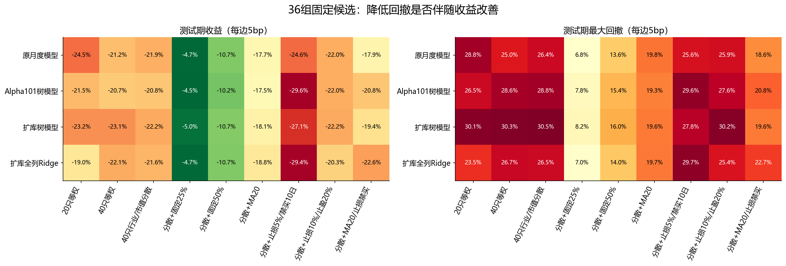
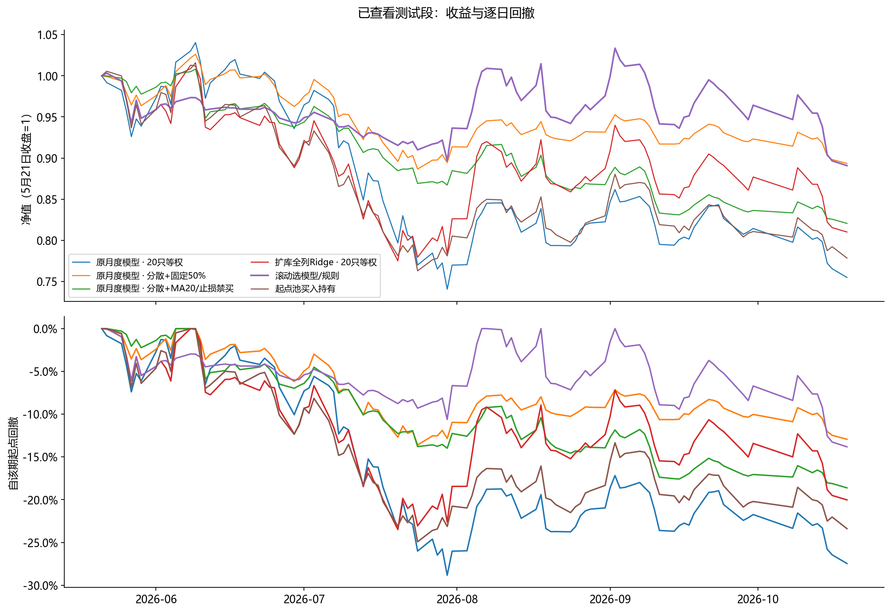
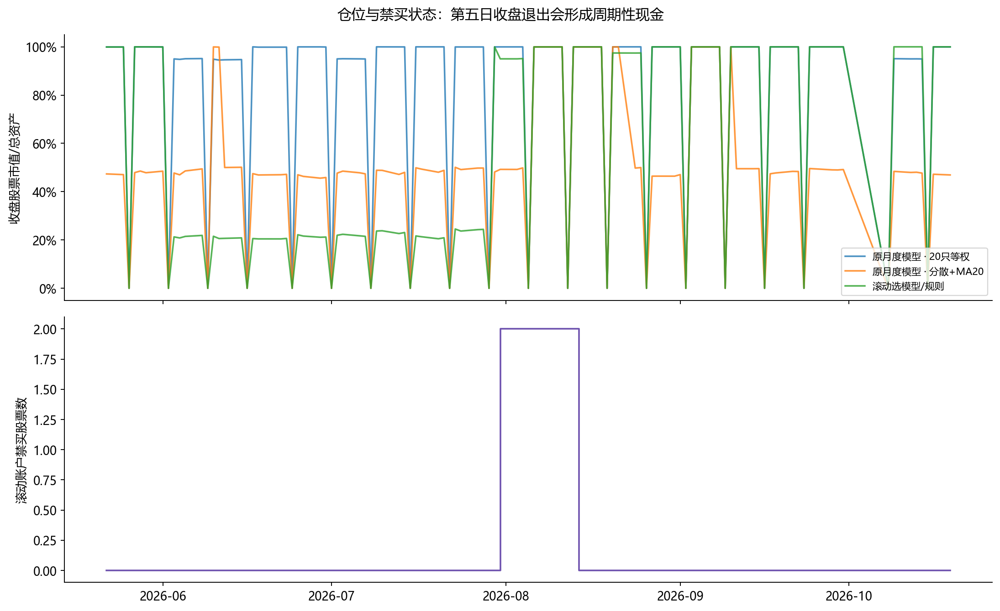
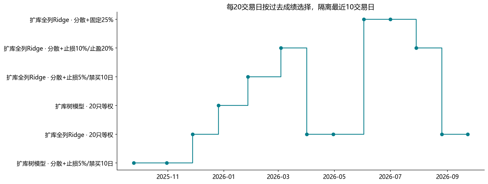
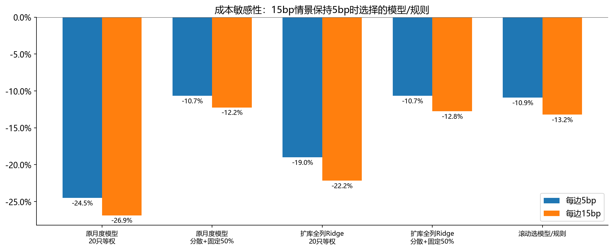

# 根据10月23日会议更新的北交所实验

本轮已实际运行 **36组固定候选、1个滚动选模型/规则账户、2个股票池基准**，并对预定账户运行15bp费用敏感性。共保存44份账户。数据截至2026-10-19，历史测试段已经看过，本轮属于探索与核验。

## 先看结果

滚动组合在2026-05-22—2026-10-19累计收益 **-10.93%**，最大回撤 **13.82%**，平均收盘仓位 **54.72%**。同一新实验起点下，原月度分数20只等权收益 **-24.52%**、最大回撤 **28.83%**；原月度分数分散后固定50%收益 **-10.66%**、回撤 **13.60%**。

收益和回撤的变化不能单独证明选股增强。需要结合固定仓位、股票池基准、费用与各月结果判断；本次不按历史最好方案宣布上线。滚动组合在所列6个自然月切片中，有5个收益超过起点股票池买入持有；5月和10月是不完整月份，样本有限。

**止损并非必然改善**：同样原月度分数、40只行业市值分散，加5%止损/10日禁买后的测试收益为-24.63%，均线加止损组合为-17.95%。滚动组合与固定50%相比仍需看全段表现，不能只拿较少亏损证明复杂规则有效。

| 方案 | 收益 | 最大回撤 | 夏普rf1.5% | 卡玛 | 平均收盘仓位 |
|---|---|---|---|---|---|
| 原月度模型 · 20只等权 | -24.52% | 28.83% | -1.82 | -1.71 | 79.15% |
| 原月度模型 · 40只行业/市值分散 | -21.88% | 26.38% | -1.64 | -1.70 | 79.84% |
| 原月度模型 · 分散+固定50% | -10.66% | 13.60% | -1.66 | -1.75 | 38.39% |
| 原月度模型 · 分散+MA20 | -17.73% | 19.83% | -2.31 | -1.90 | 47.37% |
| 原月度模型 · 分散+止损5%/禁买10日 | -24.63% | 25.57% | -2.48 | -1.94 | 67.03% |
| 原月度模型 · 分散+MA20/止损禁买 | -17.95% | 18.62% | -2.97 | -2.04 | 41.10% |
| 扩库树模型 · 40只行业/市值分散 | -22.17% | 30.54% | -1.62 | -1.49 | 80.08% |
| 扩库全列Ridge · 20只等权 | -19.00% | 23.49% | -1.29 | -1.70 | 79.76% |
| 滚动选模型/规则 | -10.93% | 13.82% | -1.11 | -1.77 | 54.72% |
| 动态池100只等权 | -25.71% | 27.80% | -2.27 | -1.84 | 73.08% |
| 起点池买入持有 | -22.17% | 24.92% | -1.95 | -1.82 | 93.11% |

## 会议要求落实了什么

| 要求 | 本轮落实 |
| --- | --- |
| 行业、市值分散 | 40只组合：行业30%、市值三组50%的建仓上限；未知信息不强行填充。名称为集中度约束，不声称严格中性。 |
| 先做简单风控 | 20日均线100%/50%、5%止损后禁买10日、10%止损/20%止盈，以及与均线组合。 |
| 避免季度极端空仓 | 每20交易日重选、每五日调仓；没有季度收益正负门槛，也没有现金候选。仍可能因到期退出、禁买或成交限制产生现金。 |
| 参数事前确定 | 固定4类分数×9条规则；每次只用之前60日结果，中间隔离10日，至少40日；所有36个候选评价留档。 |
| 滚动运行 | 保存历史已实现候选收益，按rf0夏普选择下一段，单一真实模拟账本运行，保留跨段残留；不是拼接每段赢家净值。 |
| 扩因子 | 沿用已完成的120表、2445字段目录，主版本为1601保守候选；纳入扩库树模型和全合格列Ridge，不为本次重复下载或虚称重训。 |
| 成本与交易 | 主情景每边5bp，敏感性15bp；T+1、成交额容量和涨跌停代理；止损次日尝试，失败继续持有，不凭低价假设成交。 |
| 可解释与核验 | 逐日现金/市值/权益、买卖订单、实际持有天数、退出原因、禁买记录、行业/市值暴露均保存。 |

## 全部候选及收益路径

### Q2/Q3是否仍然整季空仓

| 季度 | 收益 | 平均收盘仓位 | 收盘仓位不足1%的日数比例 |
|---|---|---|---|
| Q2 | -8.10% | 58.93% | 20.00% |
| Q3 | +2.17% | 60.55% | 20.00% |

这里的低于1%统计是**收盘时点**，第五日收盘退出也会被计入，不能解释成全天没承担风险。该滚动版本没有整季强制现金逻辑。

## 滚动究竟选了什么

最近测试段中的选择频数如下。每次选择有历史评价截止日，最新10个交易日不参与；在最早评价历史不足时，采用原月度20只等权作为固定默认。

| 模型 | 规则 | 选择次数 |
|---|---|---|
| 扩库全列Ridge | 20只等权 | 2 |
| 扩库全列Ridge | 分散+固定25% | 2 |
| 扩库全列Ridge | 分散+止损10%/止盈20% | 1 |

候选因子/模型预测复用既有滚动结果，其中扩库模型按252训练、6gap、63内部验证、6gap、21预测，按真实标签终点隔离。**此次新增的是模型与风控的外层历史选择，没有更改内层训练。**研究者早已查看过这些日期，不能把程序的时间隔离等同于全新独立测试。

## 成本与逐月结果

| 月份 | 滚动收益 | 起点池持有收益 | 差值(百分点) |
|---|---|---|---|
| 2026-05 | -5.17% | -5.88% | +0.71 |
| 2026-06 | -0.48% | -4.12% | +3.65 |
| 2026-07 | -0.78% | -10.78% | +10.00 |
| 2026-08 | +4.20% | +3.06% | +1.14 |
| 2026-09 | -1.17% | -2.30% | +1.13 |
| 2026-10 | -7.63% | -3.98% | -3.64 |

### 改善有多确定

对测试段逐日收益差做20交易日循环区块重采样，共2000次；下表为年化平均日收益差及95%分位区间，**不是累计超额收益，也不是多重比较校正后的显著性结论**。这只是对100日已查看样本的不确定性诊断。

| 比较基准 | 年化日均收益差 | 区间下界 | 区间上界 |
|---|---|---|---|
| 原月度模型 · 20只等权 | +38.17% | -32.94% | +136.48% |
| 原月度模型 · 分散+固定50% | +0.85% | -47.75% | +47.69% |
| 起点池买入持有 | +32.29% | -21.28% | +93.03% |

15bp情景保持5bp时得到的选择日程，检验同一策略对更高费用的敏感性。它不是在15bp下重新选参。买入持有从2025年7月共同起点首次入场的股票池持续持有，测试期切片保留原有持仓；动态100只等权使用同样五日调仓，是另一基准。

## 数据与结论边界

- 本轮共同账户从2025-07-02开始使用预测，之前持币；保留原调仓日历相位。与10月21日从2024年起运行的旧账户有不同初始化，因此不把结果差额全归因于新增风控。
- 行业已知覆盖95.10%，市值分组覆盖97.58%。行业使用当时已发布分类；股本快照发布时间与修订历史仍未完全独立核验。
- 30%涨跌幅、过去成交额容量只是代理；缺少完整历史ST、退市、真实涨跌停与股息到账资料，仍为研究回测。卖出不能保证止损线即最终成交损失。
- MA20参考的是动态北交所100只池等权累计收益，非北证50；行业分散不能消除全市场下跌。固定低仓位对照必须同时看。
- 本轮未连接实时数据或VNPY。模型工程对接、完整市场中性、逐事件PIT核对以及真正未看日期的纸面运行仍未完成，不声称会议所有目标已验收。
- 本地北证50参考文件仅到2026-10-12，本轮未将其不完整区间收益冒充截至10月19日的同期间基准；使用覆盖完整的两个股票池基准。
- 本轮没有新增日历日期的数据，也没有以事后最优结果替换原主流程。下一步需要固定候选和评价规则后接入新日期，持续记录真实前瞻表现。

## 如何复现和查细节

- 协议：[实验协议](实验协议.md)。结果：[全部实验结果](全部实验结果.csv)；选择：[滚动选择记录](滚动选择记录.csv)；账本检查：[账户核验](账户核验.csv)。
- 完整代码：`tools/meeting_update_20261023/`；完整Parquet：`training_runs/meeting_update_20261023/`。旧文件未覆盖。
- 顺序运行 `test_update.py`、`run_experiments.py`、`build_report.py`，使用 `.venv_research_20261011/Scripts/python.exe`。
- 8项引擎关键测试已通过（含拆股不误触发止盈）；本轮44个账户的逐日资金恒等和现金流均核对通过。源数据、预测、协议和脚本哈希保存在运行目录。
